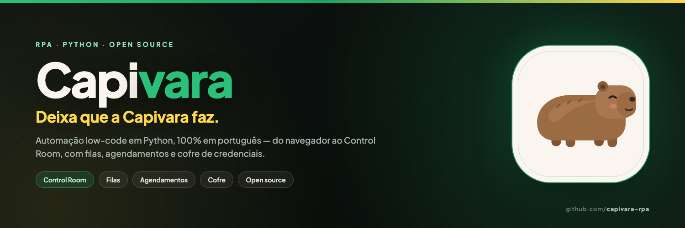

  

### Oi! 🦫

A **Capivara** é um template de RPA em Python, **100% em português**, feito para
quem quer automatizar sem decorar biblioteca: o motor vira funções descritivas e
um Control Room estilo UiPath para orquestrar tudo.

- 🧩 **Low-code de verdade** — `abrir_url`, `escrever_texto`, `ler_csv`, `enviar_email`...
- 🖥️ **Control Room** — máquinas, processos, jobs, filas, agendamentos, credenciais e auditoria.
- 🐍 **Python 3.11+** — Selenium 4, pandas, requests e Loguru por baixo.
- 🌎 **Feito no Brasil** — agendamentos com feriados nacionais e documentação em pt-BR.

[**Site**](https://arthurfaria.tech/capivara/index.html) ·
[**Repositório oficial**](https://github.com/capivara-rpa/capivara) ·
[**Guia**](https://github.com/capivara-rpa/capivara/blob/main/GUIA.md) ·
[**Comunidade**](https://github.com/capivara-rpa/capivara-community)

